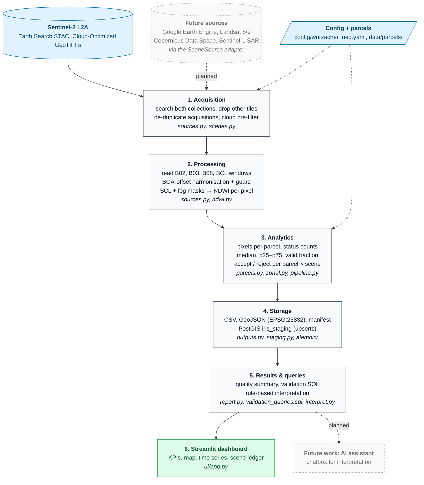

# IRIS-SAT-NDWI — Sentinel-2 Peatland Moisture Index

Task 112 · raster / satellite pipeline · destination `iris_staging`

This pipeline computes the green/NIR **NDWI** from Sentinel-2 L2A imagery for peatland parcels in the
**Wurzacher Ried** (Bad Wurzach, Baden-Württemberg; nature reserve NSG 4.035). It masks no-data and
clouds per pixel, summarises valid pixels per parcel and scene, and writes the results to CSV/GeoJSON
files and to an isolated PostGIS `iris_staging` schema. Every number in the output can be traced back to
the exact Sentinel-2 files it came from.

- **Real imagery.** The example result in [`examples/`](examples/) comes from real Sentinel-2 data
  (2021-01 → 2026-10). Synthetic data is used **only** in tests and the offline demo, and is labelled
  as synthetic in every output (`manifest.json → synthetic_data`, the run summary, and the `iris_staging.s2_ndwi_run.synthetic_data` column).
- **Quality report.** See [`QUALITY_REPORT.md`](QUALITY_REPORT.md) for coverage, rejected data, edge cases and acceptance evidence.

## Workflow



Every stage records what it drops and why (scene ledger, pixel status counts, rejection reasons), so each
number on the dashboard can be traced back through the chain to the exact Sentinel-2 files.

---

## Quick start

### Prerequisites

- **Docker route:** [Docker Desktop](https://www.docker.com/products/docker-desktop/), or Docker Engine with Compose v2.
  On macOS without Docker Desktop, [Colima](https://github.com/abiosoft/colima) works too (no admin rights needed):
  `brew install colima docker docker-compose docker-buildx`, then `colima start --vm-type vz --vz-rosetta`.
  The official `postgis/postgis` image is amd64-only, so Apple Silicon runs it emulated; Docker Desktop does this automatically, and Colima needs `--vz-rosetta`.
- **Local route:** [uv](https://docs.astral.sh/uv/getting-started/installation/) (`curl -LsSf https://astral.sh/uv/install.sh | sh`).
  uv installs Python 3.12 and the pinned dependencies by itself.
- Internet access for live runs (public Earth Search STAC/COGs, no account needed). Tests and the synthetic demo work offline.

```bash
git clone https://github.com/SomayehAhmadpour/Peatland-Moisture-Index.git
cd Peatland-Moisture-Index
```

### Docker (recommended — no local Python needed)

```bash
cp .env.example .env                    # choose a local password; .env is git-ignored
docker compose run --rm tests           # all tests, incl. PostGIS round trip
docker compose run --rm pipeline        # live run 2021-01 → 2026-10 → output/ + iris_staging (~3 min)
docker compose up ui                    # dashboard on http://localhost:8501 (Ctrl+C to stop)

# offline demo with synthetic scenes (no network):
docker compose run --rm pipeline run --config config/wurzacher_ried.yaml --source synthetic --to-db

# inspect the staging tables
docker compose exec staging-db psql -U iris_staging -d iris_staging_db

docker compose down                     # stop; add -v to also delete the staging database
```

The compose stack starts its **own** PostGIS container (`staging-db`, bound to `127.0.0.1:5434`).
It runs the Alembic migration, which creates only the `iris_staging` schema, and it never connects to `iris_core` or any
production system.

### Local (Python ≥ 3.12, uv)

```bash
uv sync                                                            # exact versions from uv.lock
uv run pytest                                                      # unit tests (offline, < 1 s)
uv run iris-ndwi parcels --config config/wurzacher_ried.yaml       # validate parcel geometries
uv run iris-ndwi run --config config/wurzacher_ried.yaml           # live run → output/<run_id>/ (~3 min)
uv run iris-ndwi run --config config/wurzacher_ried.yaml --start 2025-06-01 --end 2025-08-31   # ~30 s
uv run iris-ndwi run --config config/wurzacher_ried.yaml --source synthetic                    # offline
```

`--start`/`--end` override the configured period for one run. Add `--output-dir <dir>` to write somewhere
other than `output/`. For progress logging use `uv run iris-ndwi -v run …` (`-v` goes before `run`). Add `--to-db` to also upsert into `iris_staging`:
the connection string is read from `IRIS_STAGING_DATABASE_URL` (see `.env.example`), and nothing secret is stored in the repository.

**What a run writes.** Every run creates `output/<run_id>/`, named by UTC timestamp plus config hash:

| File | Content |
|---|---|
| `quality_summary.md` | Human-readable summary: scene ledger, acceptance per parcel, pixel statuses, summer comparison. **Start here** |
| `observations.csv` | One row per parcel × scene: pixel counts per status, NDWI statistics, accepted or rejected with reason |
| `scenes.csv` | Every STAC item found: used or rejected (with reason), baseline, offset, exact COG URLs |
| `parcels.geojson` | The parcels used, EPSG:25832 |
| `manifest.json` | Provenance: full config + SHA-256, collections, software versions, licences, counts |

### Dashboard

```bash
uv run --group ui streamlit run ui/app.py          # → http://localhost:8501, Ctrl+C to stop
```

This is a read-only Streamlit page in the style of the IRIS dashboard. It lists every run under `output/` and
`examples/runs/`, so it works without a database or network. Pick a run, a parcel, a period, months
and a scene to see:
KPIs; a map of parcel medians for the chosen scene; the parcel's NDWI time series, with the p25–p75
range and rejected dates marked; a **rule-based interpretation** ([`interpret.py`](src/iris_ndwi/interpret.py):
fixed templates, deterministic, no LLM); a same-season comparison by year; and the scene quality ledger.
A badge flags synthetic data whenever it is shown.

### Changing the configuration

Everything that is a choice rather than a fact lives in [`config/wurzacher_ried.yaml`](config/wurzacher_ried.yaml).
It is validated by a typed model ([`config.py`](src/iris_ndwi/config.py)), so a typo or an out-of-range value stops the run with a clear message.
Copy the file to experiment (`cp config/wurzacher_ried.yaml config/my_test.yaml`, then `--config config/my_test.yaml`).

| Key | Default | Meaning |
|---|---|---|
| `start_date`, `end_date` | 2021-01-01, 2026-10-26 | Acquisition period (UTC) |
| `collections` | `[sentinel-2-c1-l2a, sentinel-2-l2a]` | STAC collections in priority order |
| `mgrs_tile` | `32UNU` | Sentinel-2 tile; items from other tiles are rejected |
| `max_scene_cloud_pct` | 80 | Item-level cloud pre-filter |
| `min_valid_fraction` | 0.8 | A parcel observation is accepted when ≥ this share of its pixels is valid |
| `valid_scl_classes` | `[4, 5, 6]` | SCL classes counted as clear (vegetation, not-vegetated, water) |
| `max_blue_reflectance` | 0.12 | Fog/haze/snow test on B02; `null` disables it |
| `require_positive_reflectance` | true | Mask pixels with green or NIR ≤ 0 |
| `max_below_offset_fraction` | 0.5 | Scene guard against a double-applied BOA offset |
| `water_threshold` | 0.0 | NDWI above this counts towards `water_fraction` |
| `parcels_geojson` | OSM snapshot | GeoJSON (EPSG:4326) with `parcel_id`, `name`, `kind`, `source`, `source_ref`, `licence` properties; omit to use boxes only |
| `boxes` | core + reference | Square parcels from a WGS 84 centre, `size_m` and `snap_m` (10 = Sentinel-2 grid) |
| `max_workers` | 8 | Parallel scene reads |

**Add a parcel:** append a box (or a feature to a GeoJSON file) with a new, unique `parcel_id`
(lower-case letters, digits and `-`), then check it with `uv run iris-ndwi parcels --config …`:

```yaml
  - parcel_id: wr-forest-100m
    name: Forest east of the bog (reference)
    kind: reference
    center_lat: 47.92
    center_lon: 9.90
    size_m: 100
    snap_m: 10
```

**Another study area:** set `study_area`, the boxes and/or `parcels_geojson`, and the `mgrs_tile` that
contains them. The tile code is in the STAC item properties (`grid:code`), or you can run once: every
item from another tile is listed in `scenes.csv` as `other_mgrs_tile`. Parcels must stay inside one tile
in UTM zone 32 for EPSG:25832 to remain the appropriate metric CRS.
`scripts/fetch_osm_parcels.py` shows how to turn OSM features into a parcel file.

After changing code, run `uv run pytest`. Tests that pin exact numbers document intended behaviour
and must be updated together with a deliberate change.

### Helper scripts

```bash
# NDWI time-series chart (standalone SVG, no plotting dependency)
uv run python scripts/plot_timeseries.py output/<run_id>/observations.csv output/ndwi.svg

# Validation: same acquisitions from both collections must give the same NDWI (~5–10 min)
uv run python scripts/cross_collection_check.py --start 2023-03-01 --end 2023-10-31

# Refresh the committed OSM parcel snapshot (Overpass API)
uv run python scripts/fetch_osm_parcels.py
```

### Troubleshooting

| Symptom | Fix |
|---|---|
| `ERR_CONNECTION_REFUSED` on localhost:8501 | The dashboard isn't running. Start it and keep the terminal open |
| `Port 8501 is already in use` | Another copy is running. Use it, or add `--server.port 8502` |
| `warning: VIRTUAL_ENV=… does not match the project environment` | Harmless (an active conda/venv); run `conda deactivate` / `deactivate` to silence it |
| A few `read_error` scenes in `scenes.csv` | Transient HTTP errors from the COG host; they are recorded and the run continues. Re-run to fill them |
| `schema iris_staging does not exist` with `--to-db` | Run the migration first: `docker compose run --rm migrate` (or `uv run alembic upgrade head` with `IRIS_STAGING_DATABASE_URL` set) |

---

## Data provenance

| Item | Value |
|---|---|
| Imagery | Copernicus Sentinel-2 MSI **Level-2A** (bottom-of-atmosphere reflectance, ESA Sen2Cor) |
| Access | Element84 **Earth Search v1** STAC API `https://earth-search.aws.element84.com/v1`. The pipeline reads public Cloud-Optimized GeoTIFFs over HTTPS with range requests and needs no credentials |
| Collections (priority order) | 1. `sentinel-2-c1-l2a`: ESA Collection-1 reprocessing (processing baseline ≥ 05.00, consistent radiometry). 2. `sentinel-2-l2a`: the legacy archive, used only to fill gaps (on Earth Search, C1 lacks Jan–Nov 2022 for this tile) |
| Tile / CRS | MGRS **32UNU**, native EPSG:32632 (UTM 32N / WGS 84) |
| Bands | B03 green and B08 NIR (10 m) for NDWI; B02 blue (10 m) for the fog/haze test; SCL scene classification (20 m) |
| Licence | Copernicus Sentinel data are free and open ([Sentinel data legal notice](https://sentinels.copernicus.eu/documents/247904/690755/Sentinel_Data_Legal_Notice)). Outputs contain *modified Copernicus Sentinel data [2021–2026]* |
| Parcels | OpenStreetMap: nature reserve `way/688159107` (NSG 4.035, WDPA 6979) and bog `relation/2958383` (`wetland=bog`), © OpenStreetMap contributors, **ODbL 1.0**. Snapshot committed in [`data/parcels/`](data/parcels/), regenerated with [`scripts/fetch_osm_parcels.py`](scripts/fetch_osm_parcels.py) |
| Stable identifiers | STAC `item_id` for scenes. `parcel_id` (e.g. `wr-nsg-4035`, with an OSM `source_ref`) for parcels. `observation_id = parcel_id:item_id:method_version` for results |

Each run writes a `manifest.json` containing the full configuration and its SHA-256 hash, the software
versions, the licences and the counts. `scenes.csv` lists **every** STAC item found, whether it was used
or rejected (with the reason), and the exact COG URLs that were read.

**Why not Google Earth Engine?** GEE needs a Google account or service-account credentials. That would
break "never include secrets" and stop reviewers running the stack without their own account. It also
runs the processing server-side, which makes per-pixel auditing harder. A source adapter for GEE could
be added behind the same `SceneSource` protocol ([`sources.py`](src/iris_ndwi/sources.py)).

## Study area and parcels

| `parcel_id` | Kind | Area | Purpose |
|---|---|---|---|
| `wr-nsg-4035` | reserve | 1 799 ha | Official nature-reserve boundary (OSM, ref NSG 4.035) |
| `wr-bog-osm` | bog | 1 166 ha | Mapped raised-bog extent; a multipolygon with 22 holes |
| `wr-core-100m` | bog-core | 1.00 ha = **100 px** | 100 m × 100 m on the open Haidgauer Hochmoor surface (47.926242 N, 9.877493 E) |
| `ref-field-100m` | reference | 1.00 ha = **100 px** | 100 m × 100 m on farmland west of the reserve (47.933030 N, 9.842128 E). Shows whether the bog signal differs from ordinary land |

The boxes are built in EPSG:25832 from their WGS 84 centre and snapped to the 10 m grid. A pixel counts
as part of a parcel when its centre falls inside the polygon. With snapping, each box therefore contains
**exactly 100 Sentinel-2 pixels**, which is tested. Both box locations were checked visually on the
true-colour image from 2025-08-13.

## Method

1. **Search** the STAC catalogue for every configured collection, using the bounding box of all
   parcels (WGS 84) and the configured date range.
2. **Select scenes.** Each rule is recorded in the scene ledger:
   - unparseable metadata → `metadata_error`
   - other MGRS tile → `other_mgrs_tile`
   - **duplicates**, meaning the same tile, platform and UTC day. These come from ESA reprocessing, from
     one pass split over two datastrips, or from the same acquisition existing in both collections. The
     pipeline keeps the item with the largest AOI coverage, then the higher collection priority, then
     the highest baseline, then the lowest tile nodata %, then the latest generation time
     → `superseded_by:<item_id>`
   - item-level cloud cover > 80 % → `scene_cloud_cover_above_max`. This is only a pre-filter to save
     downloads; whether a parcel is accepted is decided per pixel.
3. **Read** green, NIR and SCL in one window covering all parcels, in the scene's own grid (EPSG:32632).
   **Reflectances are never resampled.** The window is aligned to the shared 20 m grid, so each SCL
   pixel maps onto exactly 2 × 2 pixels at 10 m.
4. **Radiometric harmonisation.** `reflectance = DN × scale + offset`, using the `raster:bands` metadata of each item.
   Since processing baseline 04.00 (2022-01-25), L2A data carry a +1000 DN offset (−0.1 in reflectance).
   In Earth Search's *legacy* collection, items flagged `earthsearch:boa_offset_applied=true` already have the offset removed
   from their DN, yet their metadata still advertise −0.1. For those items the pipeline applies no offset.
   This was verified on the same acquisition in both forms, 2021-05-31: 03.00 DN 474 vs 05.00 DN 483.
5. **Scene guard.** If more than 50 % of clear pixels have DN below the advertised offset, the offset
   would otherwise be applied twice, so the scene is rejected as `radiometric_offset_inconsistent`. This
   catches legacy items whose flag is wrong. For example, 2022-09-13 had 94 % of clear pixels below the line,
   whereas a dark low-sun winter scene shows about 25 %.
6. **Classify pixels.** The first failing rule wins, and its status code is kept:
   `NODATA` → `SCL_MASKED` (SCL class not in {4 vegetation, 5 not-vegetated, 6 water}) →
   `BRIGHT_SURFACE` (blue reflectance > 0.12) → `NON_POSITIVE_REFLECTANCE` (green or NIR ≤ 0) →
   `ZERO_DENOMINATOR` (green + NIR = 0) → `OUT_OF_RANGE` (|NDWI| > 1).
   The blue test exists because Sen2Cor's SCL sometimes labels valley fog, haze or thin snow as land.
   For example, on 2021-11-12 fog covering the bog was classed SCL 5 and produced an NDWI of −0.12.
   On clear dates the bog and the reference field stay at ≤ 0.07 in B02, while the fog, haze and
   snow cases measured 0.14–0.74. The item's `cloud` probability layer reported 0 % for these cases, so it could not be used instead.
7. **NDWI (McFeeters 1996)** = (B03 − B08) / (B03 + B08). A zero denominator gives NaN, never ±inf, and is counted.
8. **Summarise per parcel and scene.** The pipeline reports pixel counts per status, valid fraction, mean, median, std,
   p25/p75, min/max, and water fraction (share of valid pixels with NDWI > 0). An observation is **accepted** when
   valid fraction ≥ 0.8 (inclusive); otherwise it is rejected as `no_valid_pixels`,
   `valid_fraction_below_min` or `parcel_has_no_pixels`. Statistics of rejected observations are kept for auditing.

All thresholds are set in [`config/wurzacher_ried.yaml`](config/wurzacher_ried.yaml) and validated by a
typed Pydantic model ([`config.py`](src/iris_ndwi/config.py)). Runs are deterministic: the same config and
the same STAC items give byte-identical observations, which is tested.

## Schema mapping (`iris_staging`)

Created by [`alembic/versions/0001_create_iris_staging_ndwi.py`](alembic/versions/0001_create_iris_staging_ndwi.py).
The Alembic version table lives in `iris_staging` as well. Before writing, the writer
([`staging.py`](src/iris_ndwi/staging.py)) checks that every target table is in `iris_staging`. All writes are
idempotent upserts in a single transaction.

| Table | Key | Content |
|---|---|---|
| `s2_ndwi_run` | `run_id` | timestamp + config hash, source, `synthetic_data`, method version, full manifest (JSONB) |
| `s2_ndwi_parcel` | `parcel_id` | name, kind, source, `source_ref`, licence, area, `MULTIPOLYGON` **EPSG:25832** (CHECK `ST_IsValid`, GiST index) |
| `s2_scene` | `item_id` | collection, acquisition time, platform, tile, baseline, cloud %, offset flag + applied offset, `selected`, `rejection_reason`, COG URLs |
| `s2_ndwi_observation` | `observation_id` (unique `parcel_id, item_id, method_version`) | pixel counts per status (incl. `n_bright_surface`), valid fraction, NDWI statistics, water fraction, `status`, `rejection_reason`. CHECK constraints: counts add up, NDWI in [−1, 1] |

File outputs per run, under `output/<run_id>/`: `observations.csv`, `scenes.csv`, `parcels.geojson` (EPSG:25832),
`manifest.json` and `quality_summary.md`. Validation SQL is in [`examples/validation_queries.sql`](examples/validation_queries.sql).

## Tests

`uv run pytest` runs 90 offline tests in under a second. `docker compose run --rm tests` runs all 91, adding the PostGIS
round trip, which checks SRID 25832, geometry validity and idempotent upserts and then deletes its own rows.
Synthetic scene ids carry a `SYNTHETIC_` prefix, so test data can never overwrite real rows. The tests cover:

- **NDWI:** known values; zero denominator (NaN, no warning); negative reflectance; out-of-range values;
  nodata priority; every SCL class; fog labelled as land (blue test, threshold boundary, rule order).
- **Temporal comparability:** the same surface before and after baseline 04.00 gives the same NDWI, and
  skipping the offset demonstrably biases NDWI.
- **Scene selection, using recorded real STAC items** ([`tests/fixtures/`](tests/fixtures/)):
  reprocessed duplicates 1 ms apart; a split-datastrip pair; collection priority; the legacy offset flag;
  missing assets or metadata.
- **Geometry:** a 100 m box gives exactly 100 pixels; self-intersections are repaired; empty, line or
  zero-area geometries are rejected; OSM multipolygon holes are preserved; duplicate IDs are rejected.
- **End to end (synthetic scenes):** snow, fog missed by SCL, half cloud, tile-edge nodata, read error,
  wrong tile, cloud pre-filter, double offset, an empty period, and identical results on repeated runs.

## Assumptions and limitations

- **What NDWI measures here.** Green/NIR NDWI was designed to detect **open water**. Over peat vegetation it
  responds mainly to surface wetness and canopy state, and it is **not a calibrated soil-moisture
  measurement**. For vegetation water content, NDMI (B08/B11) is usually more sensitive; it would be a
  small addition but was not requested. The water threshold NDWI > 0 is McFeeters' generic value and has
  not been calibrated for this bog.
- **Uncertainty.** L2A surface-reflectance accuracy is roughly ±0.01–0.02 in reflectance units, which
  translates to a few hundredths in NDWI for this surface. A 100-pixel box is sensitive to individual
  mixed or misclassified pixels, so the p25/p75 spread is reported alongside the median.
- **Masks.** SCL comes from Sen2Cor and can miss thin cloud or shadow edges, or mislabel snow. It is
  20 m, so each SCL pixel masks four 10 m pixels. No buffer is added around clouds. The blue-brightness
  test (0.12) is a simple empirical threshold derived from this site. It can miss thin, dark haze, and
  it would wrongly mask genuinely bright bare surfaces, which don't occur in these parcels.
- **Comparing over time.** Compare like with like: the same season (see the summer table in the report)
  and accepted observations only. Sun elevation varies from about 18° (Dec) to 65° (Jun) and is recorded per scene.
- **Collection gap.** Most of 2022 comes from the legacy collection and has different file lineage. The
  cross-collection checks in [`examples/`](examples/) quantify how well the two agree.
- **Parcel boundaries.** The OSM features are community-mapped, not the official LUBW cadastre. About 1 % of
  the OSM bog polygon (12 ha) lies outside the NSG boundary.
- **Single tile.** Only tile 32UNU is used. Parcels crossing a tile edge would get `nodata` pixels; they are
  not mosaicked across tiles.

## Repository layout

```
src/iris_ndwi/   config · parcels · scenes · sources (STAC/COG) · ndwi · zonal · pipeline · outputs · staging · report · interpret · synthetic · cli
ui/              Streamlit dashboard (optional `ui` dependency group)
alembic/         iris_staging migration
config/          example configuration (no secrets)
data/parcels/    committed OSM parcel snapshot (ODbL)
scripts/         fetch_osm_parcels.py · cross_collection_check.py · plot_timeseries.py
tests/           pytest suite + recorded real STAC fixtures
examples/        real 2021–2026 run, cross-collection checks, validation SQL
```
